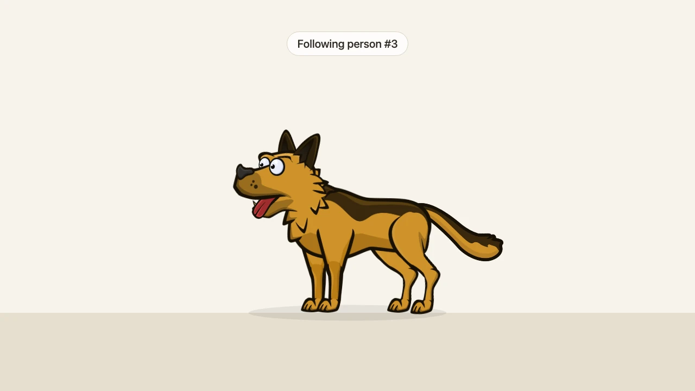

  

<h1 align="center">flwrs demos</h1>

Small, complete things built with <a href="https://github.com/hyarthi/flwrs">flwrs</a>.

[flwrs](https://github.com/hyarthi/flwrs) is a lightweight server for pluggable data flows, from simple automation to ML pipelines, that runs the same in a data centre and on an edge device. You build a flow (a "scene") from plugins and configuration, not code.

This repository holds demos of it. Each demo is a self-contained folder:

- **`./install`** checks out flwrs at its latest release, builds the server and the plugins the demo needs on your machine, downloads the models it uses (pinned versions, checked hashes), and sets up the scene.
- **`./run`** starts it all, and stops it cleanly on Ctrl+C.

Everything they produce stays in git-ignored folders inside the demo. Each demo's README lists the tools you need and any optional extras.

## Demos

<table>
  <tr>
    <td width="300"></td>
    <td>
      <b><a href="cv-dog/">cv-dog</a></b>: a cartoon dog that obeys you. A camera watches you, flwrs' vision source recognises your hand gestures and body poses, and the dog sits, begs, barks, jumps, turns around or walks alongside you.
    </td>
  </tr>
</table>

## License

The code in this repository is MIT-licensed (see [LICENSE](LICENSE)). Third-party art a demo uses isn't included and isn't covered by that license: each demo's README says what it is and where to get it, and the demo works without it.
