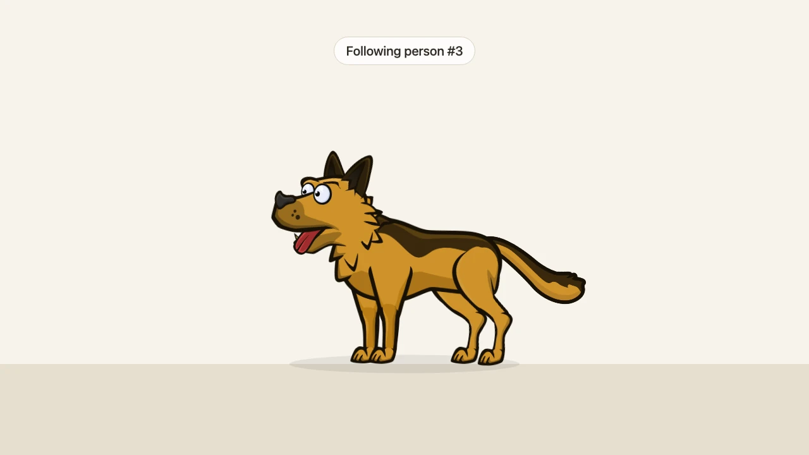
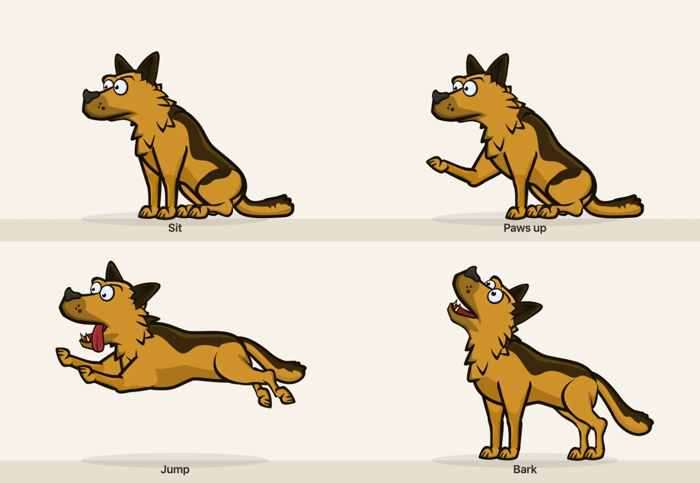
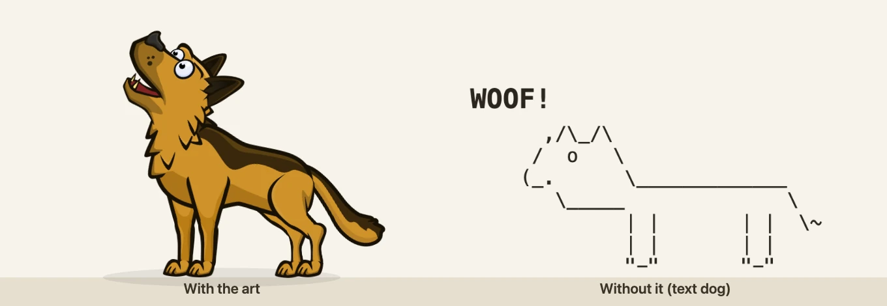
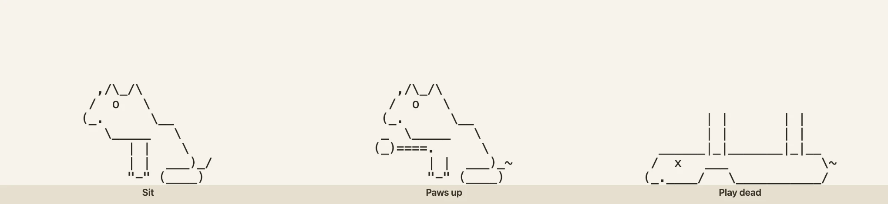

# cv-dog: a dog that obeys gestures



A camera watches you; [flwrs](https://github.com/hyarthi/flwrs) recognises your hand gestures and body poses with its vision source plugin and sends the dog commands; this page plays them.

<!-- Video: add the demo video here once it's recorded. -->



The deployment is self-contained: the scene, the model graph, its rules, the configuration and the run scripts are in this folder. `./install` builds flwrs and the plugins it needs on your machine and downloads the models; the only optional extra is the dog art below.

## Gestures

The dog obeys one person: the first to enter the picture. When that person leaves, the dog sits for 5 seconds, then follows someone else in view (or waits for the next person to come in). It reacts about half a second after a gesture is recognised and held.

| You do | The dog |
|---|---|
| 👍 thumb up | wags its tail |
| ✊ fist | sits |
| ✋ open palm | stands up |
| 🙌 both arms raised | paws up (begs) |
| ✊↔✋ open and close your hand twice | barks |
| 👎 thumb down | plays dead |
| ✌️ victory sign | jumps |
| ☝️ point your index finger up | turns around |
| walk across the picture | walks or runs alongside, at your pace |
| (you're the new owner) | wags its tail |
| (the owner leaves) | sits for 5 s |

## Run it

The full runbook (the flwrs binary, plugin packages, models, starting the scene) is in [`scene/README.md`](scene/README.md). In short: `./install` once, then `./run`, which starts the scene and serves this page at <http://127.0.0.1:8078/>.

The page is static, so it also works on its own: from any static server (for example `python3 -m http.server` in this folder, then <http://127.0.0.1:8000/>), or straight from the file. Opened from the file (`file://`), browsers don't let it read the art's files, so you get the text dog.

It listens to the scene's HTTP push sink (Server-Sent Events) at `http://127.0.0.1:8090/subscribe/dog` by default. Change it in [`config.js`](config.js) or with query parameters:

| Parameter | Default | |
|---|---|---|
| `sink` | `http://127.0.0.1:8090` | The push sink's base URL (with its `base_path`, if any). |
| `channel` | `dog` | The channel the scene publishes to. |
| `stream` | | A full stream URL, instead of `sink` + `channel`. |
| `stale_ms` | `3000` | Commands older than this (by their `time`) are ignored; `0` keeps all. |
| `mirror` | on | The dog walks the way you walk as in a mirror, which suits a front-facing webcam. `mirror=0`: as the camera's picture shows it. |
| `captions` | on | A short caption when the owner changes ("Following person #3") or leaves ("Owner left, waiting 5 s"). |
| `debug` | off | Show the debug panel at start. |
| `ascii` | off | Always use the text dog. |

For example `index.html?sink=http://192.168.1.20:8090&debug=1`. The sink must allow the page's origin (`allowed_origins`; a page opened from a file has the origin `null`).

**Without a camera:** the keyboard sends the same commands. Press <kbd>H</kbd> for the list, <kbd>G</kbd> for the debug panel (connection, recent commands, the dog's state, the owner).

| Key | Command | Key | Command |
|---|---|---|---|
| <kbd>W</kbd> | wag | <kbd>J</kbd> | jump |
| <kbd>S</kbd> | sit | <kbd>T</kbd> | turn around |
| <kbd>A</kbd> | stand up | <kbd>←</kbd> <kbd>→</kbd> | walk (with <kbd>⇧</kbd>: run) |
| <kbd>B</kbd> | paws up | <kbd>Space</kbd> | stop |
| <kbd>K</kbd> | bark | <kbd>O</kbd> / <kbd>L</kbd> | owner found / lost |
| <kbd>D</kbd> | play dead | <kbd>I</kbd> | idle |

## The dog's art

The animated dog is **"2d animated dog game sprite"** (an Alsatian) by Robert Brooks, [Game Developer Studio](https://www.gamedeveloperstudio.com/graphics/viewgraphic.php?page-name=2d-animated-dog-game-sprite&item=1u5w2l2h2g209h5r4a). It is **not included** in this repository and not covered by its MIT license: its license doesn't allow redistributing it.

To use it, buy it there and unpack it so that this file exists:

```
cv-dog/assets/dog/spriter_file_and_body_parts/alsation.scml
```

(`assets/dog/` is git-ignored.) The page plays the pack's Spriter rig from its body-part images, so the dog stays sharp at any size. Without the pack, it draws a text dog instead, with the same behaviour.





The art's license doesn't require a credit; naming it here is a courtesy. The screenshots above show this page, not the pack's files.

## Commands (for scene authors)

Each Server-Sent Event's data is a JSON object, as the sink's `raw` format or inside its `json` envelope (`{id, event, content_type, data, encoding?}`); the `event:` name doesn't matter.

```json
{"command": "walk", "person": 3, "time": 1764000000000, "direction": "left", "speed": 0.2}
```

- `command`: `idle`, `wag`, `sit`, `stand`, `beg`, `bark`, `play_dead`, `jump`, `walk`, `run`, `stop`, `turn`, `owner`, `owner_lost`.
- `person`: the owner's track id (for `owner_lost`, the person who left; shown in the debug panel and the `owner` caption).
- `time`: when it was recognised (epoch ms or s, or an ISO 8601 string). Commands older than `stale_ms` are dropped, on the first connection as well as after a reconnect, so events the sink replays from its ring don't make the dog act late.
- `walk` / `run`: `direction` (`left` / `right`, in the picture) and `speed` (picture widths per second).

How the dog behaves: sitting, begging and standing up go through the rig's own transitions (`to_sit`, `from_sit`); one-off actions (bark, jump, wag, beg) finish before the next command starts, and only the latest waiting command is kept; `owner_lost` and `stop` cut in at the end of the current animation; playing dead lasts 4 s, then the dog gets up; walking stops at the edge of the stage; a change of direction turns the dog around first.

## Files

| File | |
|---|---|
| `index.html`, `style.css`, `config.js` | The page and its defaults. |
| `js/spriter.js` | A small Spriter (`.scml`) player: bones, timelines, z-order, pivots, curves and spin, drawn on a canvas. |
| `js/rigdog.js` | Draws the rig on the stage. |
| `js/ascii.js` | The text dog (our own art). |
| `js/dog.js` | The dog's behaviour: commands → animations. |
| `js/feed.js` | The Server-Sent Events client (reconnects; ignores stale commands). |
| `js/main.js` | Wiring, keyboard and debug panel. |
| `scene/` | The flwrs scene: see [`scene/README.md`](scene/README.md). |
